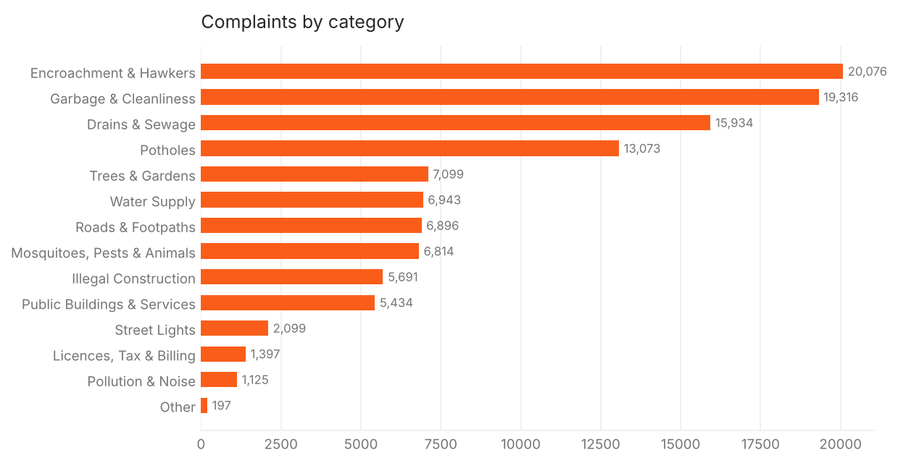
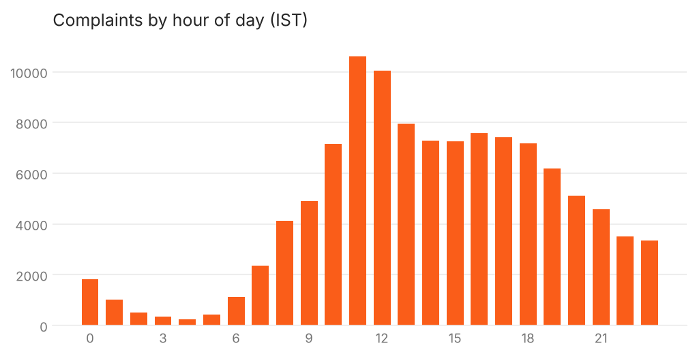
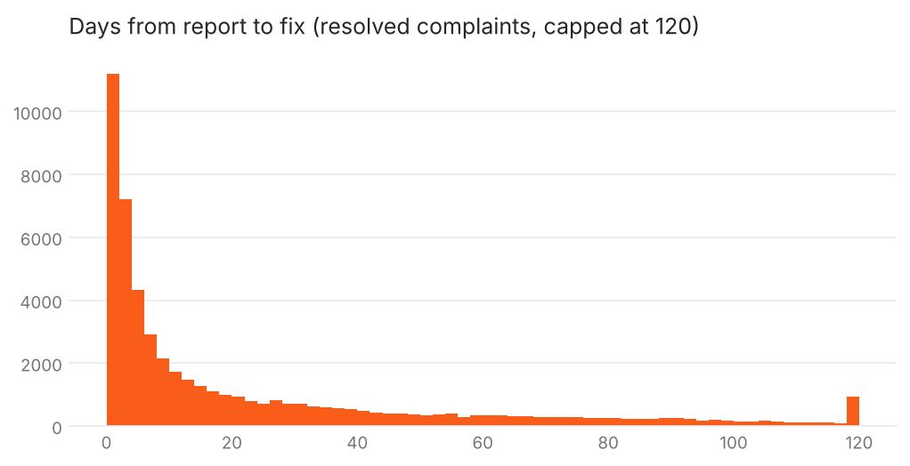
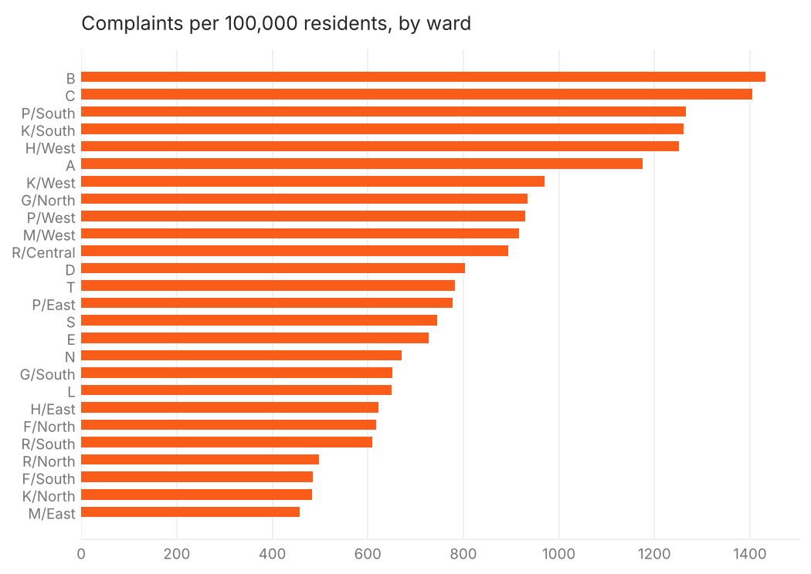

# EDA: Mumbai civic problems (BMC MARG, Mar to Oct 2026)
Unified rows: **112,094** · reported 18 Mar 2026 to 11 Oct 2026 (IST) · rows with a real map location: **96,998**. Generated by `scripts/eda.py`.

## 1. Sources and how they were joined
- Layer 0 (CCRS, every department and channel): 112,086 rows.
- Layer 16 (Pothole QuickFix): 12,060 rows. 12,037 of them have the same complaint ID as a layer 0 row, so the layers are two views of one complaint register. The pipeline joins on ID and copies the pothole fields (road type, invalid flag, resolved date) onto the layer 0 row. Only 9 pothole rows are added as new rows. 10 pothole rows have no complaint ID and are dropped.
- The old pipeline stacked both layers and then de-duplicated by ID, which silently discarded the pothole fields.

## 2. Missing values in the raw complaint layer
|                    |   % missing |
|:-------------------|------------:|
| REOPEN             |       100   |
| CURRENT_ESC_LVL    |        57.1 |
| ESCALATED_NEW      |        47.5 |
| ATTENDED           |        37.5 |
| AFTER_IMAGE_DATE   |        31   |
| INVALID            |        19   |
| COMPLAINT_ZONE     |        13.1 |
| COMPLAINT_DIVISION |        13.1 |
| COMPLAINT_REG_WARD |        12.9 |
`REOPEN` is always empty and `RESOLUTION_HRS` (layer 16) is always empty, so neither is used. Ward, zone and division are missing on ~13% of rows; almost all of those are the placeholder-location rows below.

## 3. Location quality
| channel        |   rows | with_location   |
|:---------------|-------:|:----------------|
| MyBMC app      |  52637 | 99.0%           |
| 1916 helpline  |  23009 | 36.9%           |
| X (Twitter)    |  19218 | 99.9%           |
| WhatsApp       |  11733 | 100.0%          |
| BMC web portal |   5398 | 99.9%           |
| Instagram      |     72 | 100.0%          |
| Letter         |     14 | 78.6%           |
| Email          |     13 | 92.3%           |
14,546 rows sit on one point (19.07766, 72.87741). They are almost all from the 1916 helpline, and most are Discarded. They stay in the database with `has_location = false` and empty coordinates, but they are not drawn on the map. 550 more rows have coordinates outside Greater Mumbai.

## 4. Status: "Closed" does not mean "fixed"
| COMPLAINT_STATUS   |   (empty) |    NO |   YES |
|:-------------------|----------:|------:|------:|
| CLOSED             |       392 | 51877 | 24609 |
| DISCARDED          |     13853 |    22 |     0 |
| IN PROGRESS        |         0 | 14326 |     0 |
| IN REVIEW          |      6372 |     2 |     0 |
| NEW                |       632 |     0 |     0 |
| status      |   rows | share   |
|:------------|-------:|:--------|
| Resolved    |  52261 | 46.6%   |
| Rejected    |  24626 | 22.0%   |
| In Progress |  14326 | 12.8%   |
| Discarded   |  13875 | 12.4%   |
| In Review   |   6374 | 5.7%    |
| Open        |    632 | 0.6%    |
BMC marks **24,626** complaints as CLOSED while also flagging them INVALID. The earlier app counted those as resolved, which overstated the fix rate. The unified status splits them: **Resolved** (closed and valid) and **Rejected** (closed as invalid). Of complaints that BMC closed, 68.0% were resolved and 32.0% were rejected.

## 5. What people complain about
| category                    |   rows |   open_now |   rejected_pct |
|:----------------------------|-------:|-----------:|---------------:|
| Encroachment & Hawkers      |  20076 |       4487 |           21.8 |
| Garbage & Cleanliness       |  19316 |       1361 |           20.9 |
| Drains & Sewage             |  15934 |       3407 |           16.8 |
| Potholes                    |  13073 |        993 |           39.7 |
| Trees & Gardens             |   7099 |        472 |           17.7 |
| Water Supply                |   6943 |        714 |           16.6 |
| Roads & Footpaths           |   6896 |       2789 |           19.9 |
| Mosquitoes, Pests & Animals |   6814 |       1451 |           12.5 |
| Illegal Construction        |   5691 |       1794 |           22.9 |
| Public Buildings & Services |   5434 |       2451 |           17.3 |
| Street Lights               |   2099 |        410 |           37.8 |
| Licences, Tax & Billing     |   1397 |        410 |           28.1 |
| Pollution & Noise           |   1125 |        396 |           26   |
| Other                       |    197 |        197 |            0   |

Category is derived from the complaint name the citizen picked, with BMC's department as a fallback, because the same complaint name is often routed to different departments (for example "Garbage / silt / tree branches not lifted" appears under Solid Waste, Garden and Maintenance).

## 6. When problems are reported
| reported_at   |   Potholes |   Drains & Sewage |   Garbage & Cleanliness |   Water Supply |
|:--------------|-----------:|------------------:|------------------------:|---------------:|
| 2026-03       |          0 |                 1 |                       0 |              2 |
| 2026-04       |        132 |               315 |                     307 |            129 |
| 2026-05       |        527 |              2038 |                    2439 |           1076 |
| 2026-06       |       1265 |              3126 |                    3833 |           1101 |
| 2026-07       |       3959 |              3531 |                    3774 |           1114 |
| 2026-08       |       4660 |              3095 |                    4366 |           1477 |
| 2026-09       |       2046 |              2829 |                    3389 |           1323 |
| 2026-10       |        484 |               999 |                    1208 |            721 |
Potholes and drains rise sharply with the monsoon (June to September). March and October are partial months.

Peak hour in IST is 11:00. The raw timestamps are UTC; the old app used UTC dates, which put late-evening complaints on the wrong day.

## 7. How long fixes take
| category                    |   resolved |   median days |   90th pct days |   mean days |
|:----------------------------|-----------:|--------------:|----------------:|------------:|
| Illegal Construction        |       1314 |          45   |           104.8 |        49.9 |
| Public Buildings & Services |       1458 |          38   |           109.7 |        47.6 |
| Street Lights               |        520 |          27.7 |            95.6 |        37.3 |
| Drains & Sewage             |       6872 |          21.6 |            87   |        33.8 |
| Roads & Footpaths           |       2475 |          20   |            91.1 |        35.1 |
| Water Supply                |       4669 |          16.8 |            85.9 |        30.9 |
| Pollution & Noise           |        436 |          16.7 |            95.5 |        35.5 |
| Licences, Tax & Billing     |        268 |          15   |            79.7 |        29.4 |
| Encroachment & Hawkers      |       8550 |          13   |            77   |        26.5 |
| Trees & Gardens             |       4449 |          10.9 |            51.2 |        19.8 |
| Garbage & Cleanliness       |      11493 |           4.8 |            60.1 |        17.7 |
| Mosquitoes, Pests & Animals |       3222 |           4.6 |            32.7 |        11.9 |
| Potholes                    |       6515 |           2   |             5.7 |         2.9 |

The distribution is very skewed: median 8.4 days, mean 23.3 days. The app shows medians for that reason. Closure time is the date of BMC's "after" photo, which is the best closure signal the service publishes.

## 8. Wards
| ward   | name      | areas                                  |   rows |   per_100k |   open_now |   fix_rate |   median_days |
|:-------|:----------|:---------------------------------------|-------:|-----------:|-----------:|-----------:|--------------:|
| B      | B         | Dongri, Masjid Bunder, Sandhurst Road  |   1823 |       1432 |        144 |       81.8 |           5.9 |
| C      | C         | Marine Lines, Kalbadevi, Bhuleshwar    |   2334 |       1405 |        186 |       74.4 |           4   |
| PS     | P/South   | Goregaon                               |   5922 |       1266 |       1126 |       79.5 |           8.3 |
| KS     | K/South   | Andheri East, Vile Parle East          |   4834 |       1261 |       1368 |       76.5 |           9.7 |
| HW     | H/West    | Bandra West, Khar West, Santacruz West |   4122 |       1251 |       1095 |       58.6 |           7.3 |
| A      | A         | Colaba, Fort, Cuffe Parade             |   2176 |       1176 |        391 |       43.1 |           6.8 |
| KW     | K/West    | Andheri West, Vile Parle West, Juhu    |   6920 |        970 |       1046 |       65.9 |          15.5 |
| GN     | G/North   | Dadar, Mahim, Dharavi                  |   5457 |        935 |        515 |       75.9 |          10.1 |
| PW     | P/West    | Malad West, Marve, Madh                |   4158 |        929 |        824 |       68   |          11.8 |
| MW     | M/West    | Chembur, Tilak Nagar                   |   3714 |        917 |       1061 |       65.5 |          13.3 |
| RC     | R/Central | Borivali                               |   5029 |        894 |       2017 |       71.3 |           4.8 |
| D      | D         | Grant Road, Malabar Hill, Tardeo       |   2784 |        803 |        410 |       64.7 |           8.1 |
| T      | T         | Mulund                                 |   2664 |        782 |        518 |       72.6 |           7   |
| PE     | P/East    | Malad East                             |   3982 |        778 |        833 |       59.2 |           7   |
| S      | S         | Bhandup, Powai, Kanjurmarg             |   5540 |        745 |       1179 |       58.4 |           6   |
| E      | E         | Byculla, Mazgaon, Agripada             |   2859 |        728 |        287 |       73.9 |           6   |
| N      | N         | Ghatkopar, Vikhroli                    |   4206 |        671 |        816 |       78.6 |          10.9 |
| GS     | G/South   | Worli, Prabhadevi, Lower Parel         |   2564 |        652 |        401 |       72.9 |           6.2 |
| L      | L         | Kurla, Sakinaka, Chandivali            |   5841 |        650 |       1423 |       57.2 |           7.5 |
| HE     | H/East    | Bandra East, Khar East, Santacruz East |   3467 |        622 |        883 |       66.1 |          12.7 |
| FN     | F/North   | Matunga, Sion, Wadala                  |   3276 |        618 |        454 |       53.7 |           6.8 |
| RS     | R/South   | Kandivali                              |   4158 |        610 |       1407 |       78.4 |          10.8 |
| RN     | R/North   | Dahisar                                |   2147 |        498 |        360 |       71   |          12.8 |
| FS     | F/South   | Parel, Sewri, Lalbaug                  |   1749 |        485 |        325 |       72.9 |          12.8 |
| KN     | K/North   | Jogeshwari East, Marol                 |   2131 |        484 |        860 |       79.5 |           6.2 |
| ME     | M/East    | Govandi, Mankhurd, Deonar              |   3734 |        458 |        771 |       55   |           6.1 |

`fix_rate` = Resolved / (Resolved + Rejected). Population comes from BMC's ward boundary layer.

## 9. Escalation
| category                    |   % escalated |
|:----------------------------|--------------:|
| Pollution & Noise           |          76.8 |
| Public Buildings & Services |          71.6 |
| Drains & Sewage             |          66.8 |
| Roads & Footpaths           |          66.3 |
| Trees & Gardens             |          56.3 |
| Street Lights               |          54.4 |
| Illegal Construction        |          53.4 |
| Water Supply                |          52.2 |
| Garbage & Cleanliness       |          49.7 |
| Encroachment & Hawkers      |          48.4 |
| Licences, Tax & Billing     |          42.4 |
| Potholes                    |          37.8 |
| Mosquitoes, Pests & Animals |          33   |
| Other                       |           0   |
Escalation is BMC's own flag for complaints that passed their first deadline.

## 10. Decisions for the unified dataset
- One row per complaint ID. Pothole QuickFix fields are merged onto the matching CCRS row.
- Times are stored as timestamps with the IST offset (`reported_at`, `closed_at`).
- Status vocabulary: Open, In Review, In Progress (all `is_open = true`), Resolved, Rejected, Discarded.
- `days_to_close` is filled for Resolved and Rejected rows only. Values below 0 or above 400 days are blanked.
- Rows with no real location are kept with `has_location = false` and null coordinates, so city totals stay complete.
- Ward is filled by point-in-polygon when BMC left it blank and the point is real. Zone and division are filled from the ward.
- Categories: 14 citizen-facing groups (see `CATEGORY_RULES` in `scripts/build_dataset.py`).
- Citizen reports from the app go into the same `problems` table with `source = 'citizen'`.
